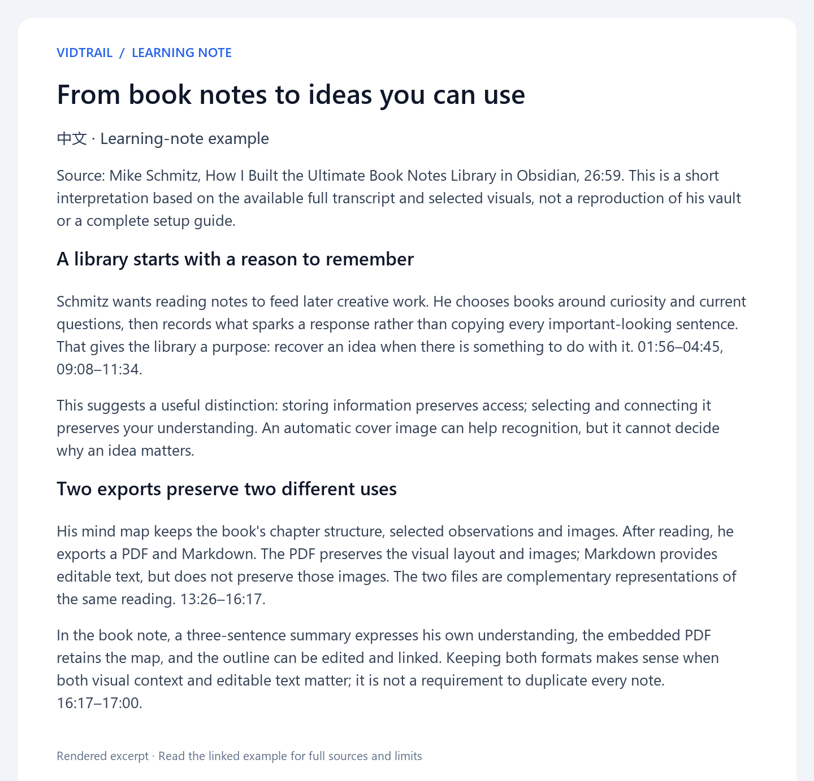
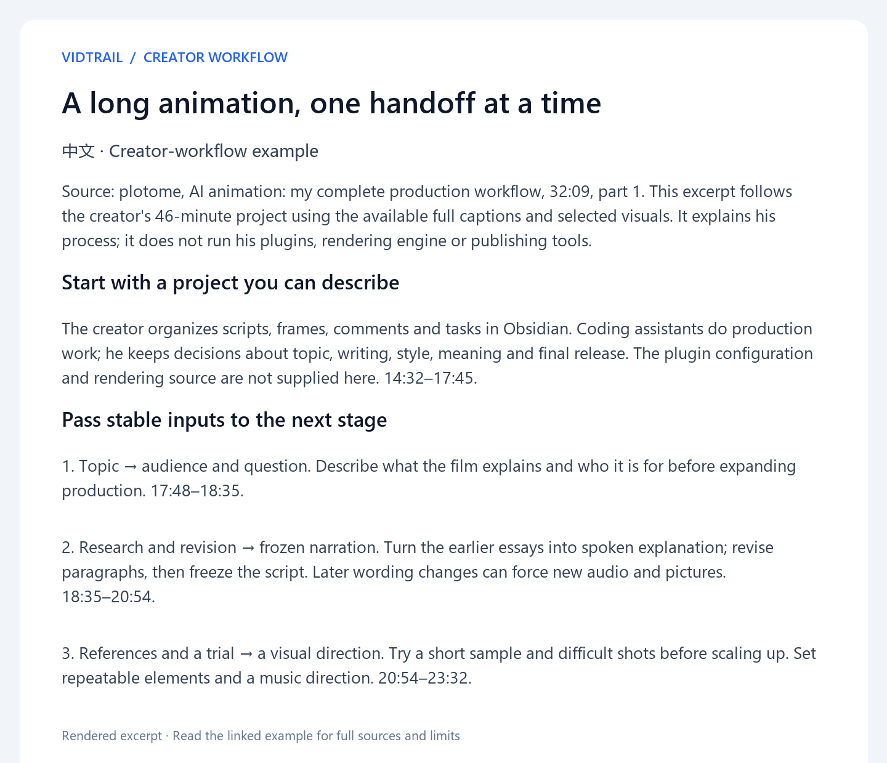

# VidTrail · 观迹

[中文](README.zh-CN.md)

Let your agent find useful Bilibili and YouTube videos, then turn their available content into clear learning notes or a guide to the creator’s process. Start with a topic, a link or a transcript you already have.

## See what you can get

### Understand a method

> Use $vidtrail to explain why this Obsidian book-note workflow keeps both PDF and Markdown. Write a learning note using the creator’s example.

[](docs/assets/learning-note-preview.png)

The note connects the format choices to their later use. The diagram is our explanation of the source, and the full example keeps the relevant video times.

[Read the learning note](docs/examples/learning-note.md) · [中文](docs/examples/learning-note.zh-CN.md)

### Follow the creator’s process

> Use $vidtrail to explain how plotome moves a long animation from script to release. Show what each stage needs, produces and leaves for a human to decide.

[](docs/assets/creator-workflow-preview.png)

The workflow follows handoffs and review points, with missing implementation details kept explicit. It describes the creator’s work; it does not run the production process.

[Read the creator workflow](docs/examples/creator-workflow.md) · [中文](docs/examples/creator-workflow.zh-CN.md)

## Install and try it

Use an agent that loads Agent Skills and can read files. Python 3.10+ runs the installer and optional acquisition helper.

```sh
git clone https://github.com/glcj2726-wq/vidtrail.git
cd vidtrail
python scripts/install_skill.py --project /absolute/path/to/your-project --copy
```

Open a new chat in the target project. Codex can invoke the skill with `$vidtrail`; other hosts follow their own discovery and invocation conventions. Existing skills are preserved.

With a transcript you already have:

> Use $vidtrail with this transcript. Write learning notes in Chinese and save them in this project’s existing notes folder.

With a video link:

> Use $vidtrail with this video link. Explain the creator’s workflow and include source times for important steps.

Supplied transcripts do not require platform login or download tools. For live acquisition, check the [setup guide](.agents/skills/vidtrail/references/setup.md) for available tools and authorized access. If you only want candidate videos, say so and the skill stops after comparison.

## From source to result

**Find or select → reuse materials → obtain missing text → read the available full content → check necessary visuals → write and deliver.**

Ask for learning notes, a creator workflow or both, in your preferred language. Deliver into your chosen location. Downloads and transcription are optional routes when needed and authorized; Quark, Notion and a separate tutoring skill are not required.

## Before you rely on a result

Platform access varies with the source, network and account. A failed request can leave a useful transcript available; incomplete text or unreadable visuals limit what the result can establish. VidTrail explains the gap and does not invent missing steps or automatically log in and retry. See [platform guidance](.agents/skills/vidtrail/references/platforms.md) and [actual checks and limits](docs/RELEASE_CHECKS.md).

[Full skill](.agents/skills/vidtrail/SKILL.md) · [Method sources](ATTRIBUTION.md) · [MIT license](LICENSE)

For feedback, describe what you asked for, what happened and a minimal reproducible case. Keep credentials and private source materials out of reports. External tools and source videos retain their own terms.
