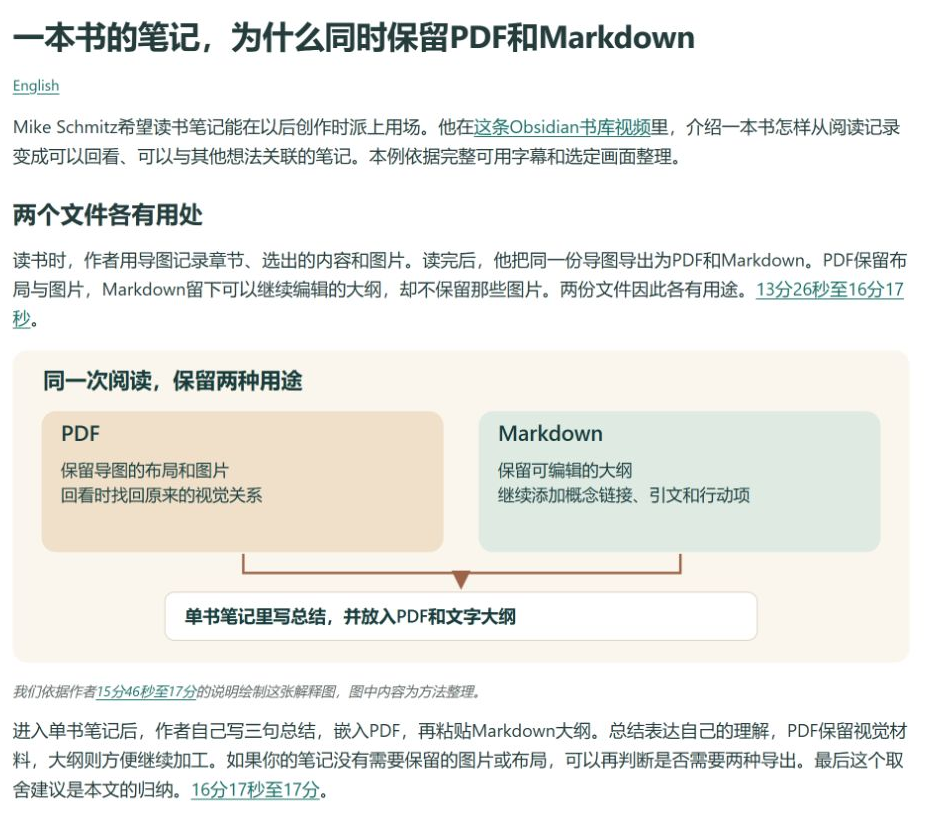
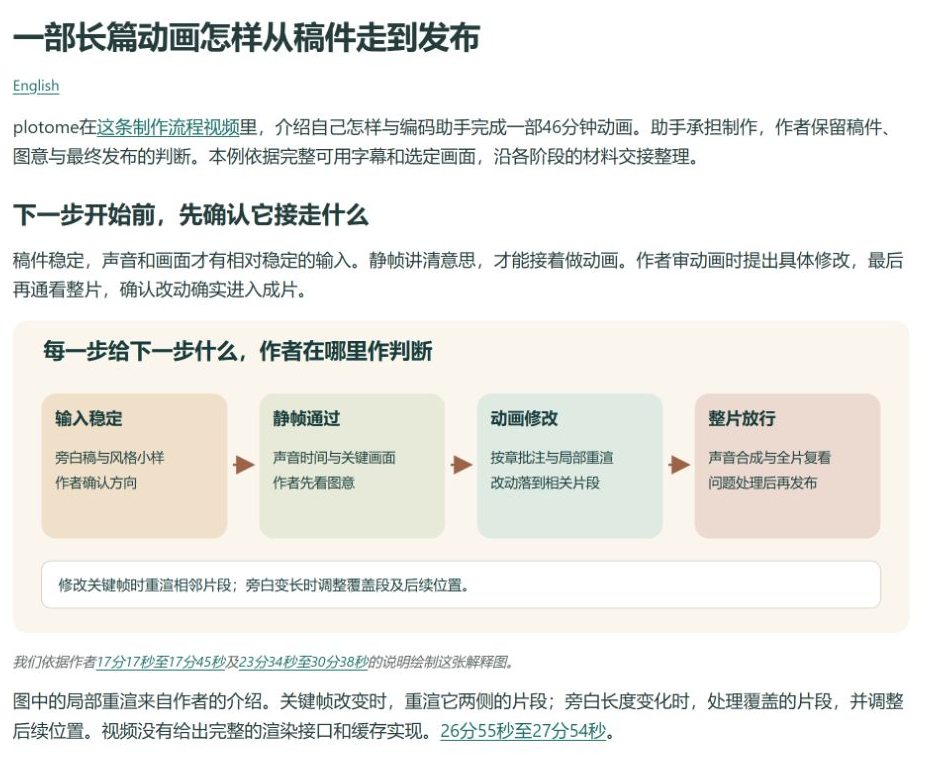

# 观迹 · VidTrail

[English](README.md)

让Agent帮你找B站和YouTube视频，整理成讲得明白的学习笔记或作者工作流。可以从一个主题开始，也可以直接给链接或已有字幕。

## 先看看能得到什么

### 把方法读明白

> 用 $vidtrail 解释这套Obsidian书籍笔记为什么同时保留PDF和Markdown。沿作者的例子，写成学习笔记。

[](docs/assets/learning-note-preview.zh-CN.png)

笔记把格式选择和后续用途连起来讲，解释图由我们依据来源绘制。完整示例保留原片时间，方便回看。

[阅读学习笔记](docs/examples/learning-note.zh-CN.md) · [English](docs/examples/learning-note.md)

### 看清作者怎样一步步做

> 用 $vidtrail 整理plotome制作长篇动画的流程，说明每一步拿到什么、交出什么，以及哪些地方由作者判断。

[](docs/assets/creator-workflow-preview.zh-CN.png)

工作流说明材料怎样交接、作者在哪里检查，并交代缺少的实现细节。这份示例解释作者的做法，制作过程未实际执行。

[阅读作者工作流](docs/examples/creator-workflow.zh-CN.md) · [English](docs/examples/creator-workflow.md)

## 安装后试一下

需要能加载Agent Skills并读取文件的Agent。安装程序和可选获取脚本使用Python 3.10及以上版本。

```sh
git clone https://github.com/glcj2726-wq/vidtrail.git
cd vidtrail
python scripts/install_skill.py --project /你的项目绝对路径 --copy
```

在目标项目新开聊天。Codex中可以用`$vidtrail`调用，其他宿主按实际支持的加载方式使用。安装会保留已有技能。

手头已经有字幕时，可以这样说。

> 用 $vidtrail 读这份字幕，写中文学习笔记，保存到项目已有的笔记目录。

给视频链接时，可以这样说。

> 用 $vidtrail 整理这个视频的作者工作流，给关键步骤加上原片时间。

使用已有字幕不需要先登录平台或安装下载器。需要在线获取时，按[配置说明](.agents/skills/vidtrail/references/setup.md)检查实际工具与授权。只想找几条候选视频，也可以直接说明，技能会止于比较。

## 从材料到成果

**寻找或选定 → 复用已有材料 → 获取缺失正文 → 阅读全部可用内容 → 核对必要画面 → 写作并交付。**

可以只写学习笔记，也可以整理作者工作流，两份都要也行。用什么语言、存到哪里，都按你的要求来。需要下载或转写时，再使用你允许的工具，无须绑定夸克、Notion或另一套带学技能。

## 使用时留意材料范围

能否获取内容与视频、网络和账号有关。在线请求失败后，已有字幕仍可能足够继续整理；正文不全或关键画面看不清，会影响能得出哪些结论。VidTrail会说明具体缺口，不补造步骤，也不自动登录和重复请求。详见[平台说明](.agents/skills/vidtrail/references/platforms.md)和[实际验证结果](docs/RELEASE_CHECKS.md)。

[完整技能](.agents/skills/vidtrail/SKILL.md) · [方法来源](ATTRIBUTION.md) · [MIT许可证](LICENSE)

反馈时请说明你提出了什么要求、实际遇到什么情况，并给出能复现问题的最小材料。不要附凭据或私人原件。外部工具和原视频保留各自条款。
