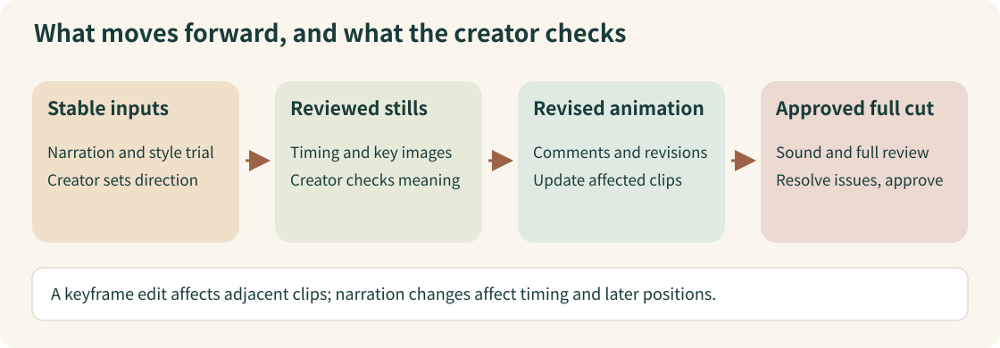

# How a long animation moves from script to release

[中文](creator-workflow.zh-CN.md)

In [plotome’s production walkthrough](https://www.bilibili.com/video/BV1xFnt6zE3K/?p=1), coding assistants make much of a 46-minute animation. The creator keeps the decisions about the script, visual meaning and release. This example follows what each stage passes forward, using the full available captions and selected visuals.

## Review the input before the next stage uses it

A stable script gives narration and images something dependable to work from. Once a frame conveys the intended meaning, it can become an animation input. Reviewing that animation produces specific changes; reviewing the assembled film checks whether those changes reached the final cut.

*Our explanatory diagram of the source process, from [17:17–17:45](https://www.bilibili.com/video/BV1xFnt6zE3K/?p=1&t=1037) and [23:34–30:38](https://www.bilibili.com/video/BV1xFnt6zE3K/?p=1&t=1414). It is not a screenshot of the creator’s tools.*

The local-render rule in the diagram is the creator’s account. A changed keyframe affects its adjacent clips; a changed narration length affects the covered clips and later positions. The video does not provide the full rendering interface or cache implementation. [26:55–27:54](https://www.bilibili.com/video/BV1xFnt6zE3K/?p=1&t=1615).

## Follow the project through its handoffs

| Stage | What comes in and what happens | What moves forward |
| --- | --- | --- |
| Choose the topic | Define what the film explains and who it is for | A clear topic and audience. [17:48–18:35](https://www.bilibili.com/video/BV1xFnt6zE3K/?p=1&t=1068) |
| Freeze the script | Research, discuss and revise the earlier essays into spoken explanation | Approved narration. Later wording changes may require audio and image changes. [18:35–20:54](https://www.bilibili.com/video/BV1xFnt6zE3K/?p=1&t=1115) |
| Set the visual direction | Compare references, trial difficult shots and make a short sample | Agreed tools, recurring elements and a music direction. [20:54–23:32](https://www.bilibili.com/video/BV1xFnt6zE3K/?p=1&t=1254) |
| Review narration and stills | Use sentence timings; check what each image communicates | Timing and key images ready for animation. The described project used sentence boundaries. [23:34–26:30](https://www.bilibili.com/video/BV1xFnt6zE3K/?p=1&t=1414) |
| Review animation | Watch chapters, attach comments to relevant lines/frames, revise affected segments | Chapters whose timing, transitions and meaning have been reviewed. [26:34–27:54](https://www.bilibili.com/video/BV1xFnt6zE3K/?p=1&t=1594) |
| Review the full cut | Add sound, assemble chapters, watch the full film and track issues | A cut ready for the creator’s approval, with changes checked in the delivered version. [27:54–29:59](https://www.bilibili.com/video/BV1xFnt6zE3K/?p=1&t=1674) |
| Prepare publication | AI prepares uploads, titles and covers; the creator checks and edits | A human decision to publish. [29:59–30:38](https://www.bilibili.com/video/BV1xFnt6zE3K/?p=1&t=1799) |

## What you would still need to reproduce it

The creator uses Obsidian for scripts, frames, comments and tasks. The exact plugin configuration, project files and rendering source are not supplied here. Those missing details prevent this example from serving as an installation guide. [14:32–17:45](https://www.bilibili.com/video/BV1xFnt6zE3K/?p=1&t=872).

You can still borrow the handoffs and review decisions when designing your own process. Any replacement tools would be a separate design, and reported cost or production time remains the creator’s account of one project.

### Source and coverage

plotome, Bilibili `BV1xFnt6zE3K`, part 1, 32:09. All 848 retained caption items and selected visuals informed this example. It explains the source workflow; no plugins, rendering engine or publishing tools were run.
