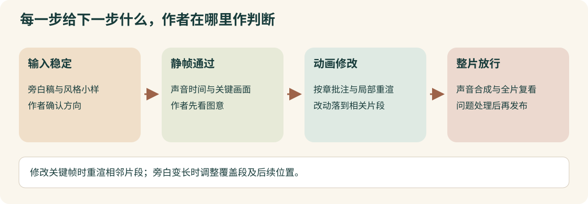

# 一部长篇动画怎样从稿件走到发布

[English](creator-workflow.md)

plotome在[这条制作流程视频](https://www.bilibili.com/video/BV1xFnt6zE3K/?p=1)里，介绍自己怎样与编码助手完成一部46分钟动画。助手承担制作，作者保留稿件、图意与最终发布的判断。本例依据完整可用字幕和选定画面，沿各阶段的材料交接整理。

## 下一步开始前，先确认它接走什么

稿件稳定，声音和画面才有相对稳定的输入。静帧讲清意思，才能接着做动画。作者审动画时提出具体修改，最后再通看整片，确认改动确实进入成片。

*我们依据作者[17分17秒至17分45秒](https://www.bilibili.com/video/BV1xFnt6zE3K/?p=1&t=1037)及[23分34秒至30分38秒](https://www.bilibili.com/video/BV1xFnt6zE3K/?p=1&t=1414)的说明绘制这张解释图。*

图中的局部重渲来自作者的介绍。关键帧改变时，重渲它两侧的片段；旁白长度变化时，处理覆盖的片段，并调整后续位置。视频没有给出完整的渲染接口和缓存实现。[26分55秒至27分54秒](https://www.bilibili.com/video/BV1xFnt6zE3K/?p=1&t=1615)。

## 沿着材料交接走一遍

| 阶段 | 拿到什么，做什么 | 交给下一步什么 |
| --- | --- | --- |
| 选题 | 说明讲什么、给谁看 | 清楚的选题与受众。[17分48秒至18分35秒](https://www.bilibili.com/video/BV1xFnt6zE3K/?p=1&t=1068) |
| 稿件冻结 | 调研、讨论，将此前文章逐段改成适合听的解释 | 已确认的旁白稿，后续改字可能连带修改声音和画面。[18分35秒至20分54秒](https://www.bilibili.com/video/BV1xFnt6zE3K/?p=1&t=1115) |
| 风格确定 | 比较参考，试难镜头，制作短样片 | 工具、重复元素和音乐方向。[20分54秒至23分32秒](https://www.bilibili.com/video/BV1xFnt6zE3K/?p=1&t=1254) |
| 声音与静帧 | 按句子时间组织画面，作者先审图意 | 可以进入动画的关键画面与声音时间；原项目做到句子边界。[23分34秒至26分30秒](https://www.bilibili.com/video/BV1xFnt6zE3K/?p=1&t=1414) |
| 动画审阅 | 按章看，将批注放到对应句和画面，修改相关片段 | 节奏、转场和图意经过检查的章节。[26分34秒至27分54秒](https://www.bilibili.com/video/BV1xFnt6zE3K/?p=1&t=1594) |
| 整片审阅 | 配声音、拼章节，从头通看并追踪问题 | 供作者放行的成片，修改已经核对到交付版本。[27分54秒至29分59秒](https://www.bilibili.com/video/BV1xFnt6zE3K/?p=1&t=1674) |
| 发布准备 | AI准备上传、标题和封面，作者检查修改 | 由人决定是否发布。[29分59秒至30分38秒](https://www.bilibili.com/video/BV1xFnt6zE3K/?p=1&t=1799) |

## 真要复刻，还需要哪些材料

作者使用Obsidian组织稿件、画面、批注和任务。这里没有随附准确的插件配置、项目文件和渲染源码，暂时还不能据此写出完整安装教程。[14分32秒至17分45秒](https://www.bilibili.com/video/BV1xFnt6zE3K/?p=1&t=872)。

现有材料足以借鉴各阶段怎样交接、作者在哪里检查。替换工具后的做法需要另行设计；作者报告的成本与制作时间，也只对应他这一次项目。

### 来源与阅读范围

作者为plotome，B站视频编号`BV1xFnt6zE3K`，P1，长32分9秒。本例参考全部848条现有字幕与选定画面，尚未运行其插件、引擎或发布工具。
