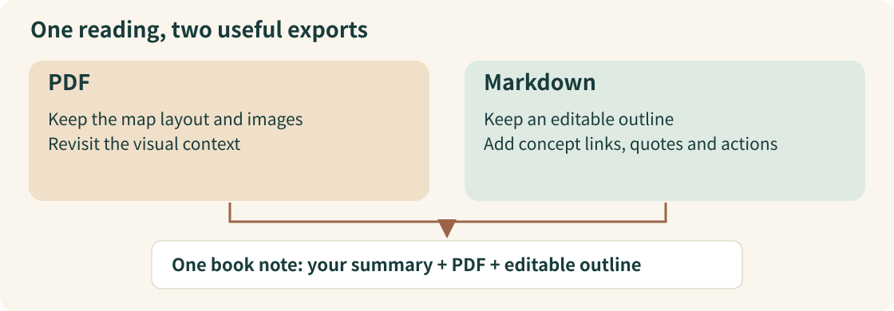

# Why a book note keeps both PDF and Markdown

[中文](learning-note.zh-CN.md)

Mike Schmitz wants his reading notes to help with later creative work. In [his Obsidian book-library video](https://www.youtube.com/watch?v=P57Bg5yIkdA), he follows one book from reading to a note he can revisit and connect to other ideas. This example draws on the full available transcript and selected visuals.

## Two files, two jobs

While reading, Schmitz keeps a mind map with chapter headings, selected observations and images. After finishing, he exports it twice. The PDF preserves the layout and pictures. Markdown gives him an outline he can edit, but leaves out those pictures. Keeping both preserves different parts of the same reading. [13:26–16:17](https://www.youtube.com/watch?v=P57Bg5yIkdA&t=806s).

*Our explanatory diagram, based on the creator’s account at [15:46–17:00](https://www.youtube.com/watch?v=P57Bg5yIkdA&t=946s). It is not a frame from the video.*

In the resulting book note, he writes a three-sentence summary, embeds the PDF and pastes the Markdown outline. The summary states his understanding; the PDF keeps the visual material; the outline remains available for editing. If your notes contain no useful images or layout, that is a reason to reconsider whether you need both exports. This last suggestion is our interpretation. [16:17–17:00](https://www.youtube.com/watch?v=P57Bg5yIkdA&t=977s).

## The outline can now connect to other work

Schmitz links concepts to separate notes, gives quotes an author link and a `#quote` tag, and marks actions with `#todo`. A book keeps its own context while its ideas can join a broader question. [17:00–18:30](https://www.youtube.com/watch?v=P57Bg5yIkdA&t=1020s).

Those connections depend on choices made during reading. He selects books around curiosity and current questions, then records what prompts a response instead of copying every important-looking sentence. That makes it easier to explain why a passage was worth keeping. [01:56–04:45](https://www.youtube.com/watch?v=P57Bg5yIkdA&t=116s), [09:08–11:34](https://www.youtube.com/watch?v=P57Bg5yIkdA&t=548s).

## Metadata makes the same notes easier to find

Book Search creates a templated note and fills metadata. Schmitz then embeds the PDF, pastes the outline and refines links. Bases offers different views of these same notes, including a five-star view, without making another set of copies. [20:32–21:25](https://www.youtube.com/watch?v=P57Bg5yIkdA&t=1232s), [21:25–24:16](https://www.youtube.com/watch?v=P57Bg5yIkdA&t=1285s).

The useful idea is to preserve the material in a form you can work with, then give it meaningful connections. This is our reading of the method. The example explains those choices; a complete vault setup would still need the actual templates, settings and queries.

### Source and coverage

Mike Schmitz, *How I Built the Ultimate Book Notes Library in Obsidian*, 26:59. The retained English captions cover the available full text, with a truncated final sentence. Selected visuals were checked; his vault was not deployed and his workflow was not executed. The closing product promotion is not a prerequisite for learning the method.
