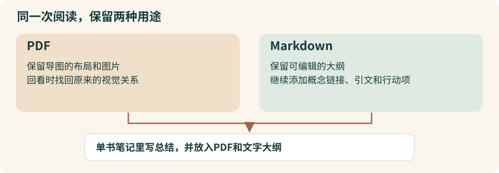

# 一本书的笔记，为什么同时保留PDF和Markdown

[English](learning-note.md)

Mike Schmitz希望读书笔记能在以后创作时派上用场。他在[这条Obsidian书库视频](https://www.youtube.com/watch?v=P57Bg5yIkdA)里，介绍一本书怎样从阅读记录变成可以回看、可以与其他想法关联的笔记。本例依据完整可用字幕和选定画面整理。

## 两个文件各有用处

读书时，作者用导图记录章节、选出的内容和图片。读完后，他把同一份导图导出为PDF和Markdown。PDF保留布局与图片，Markdown留下可以继续编辑的大纲，却不保留那些图片。两份文件因此各有用途。[13分26秒至16分17秒](https://www.youtube.com/watch?v=P57Bg5yIkdA&t=806s)。

*我们依据作者[15分46秒至17分](https://www.youtube.com/watch?v=P57Bg5yIkdA&t=946s)的说明绘制这张解释图，图中内容为方法整理。*

进入单书笔记后，作者自己写三句总结，嵌入PDF，再粘贴Markdown大纲。总结表达自己的理解，PDF保留视觉材料，大纲则方便继续加工。如果你的笔记没有需要保留的图片或布局，可以再判断是否需要两种导出。最后这个取舍建议是本文的归纳。[16分17秒至17分](https://www.youtube.com/watch?v=P57Bg5yIkdA&t=977s)。

## 文字大纲可以继续参与其他问题

作者把概念链接到独立笔记，给引文加上作者链接和`#quote`，给行动项加上`#todo`。每本书保留自己的语境，其中的想法又能与其他材料关联。[17分至18分30秒](https://www.youtube.com/watch?v=P57Bg5yIkdA&t=1020s)。

这些关联依赖阅读时的选择。他围绕好奇心和当前问题选书，记录能引发回应的内容。以后回看，便更容易说明自己为什么记下这一段。[1分56秒至4分45秒](https://www.youtube.com/watch?v=P57Bg5yIkdA&t=116s)、[9分8秒至11分34秒](https://www.youtube.com/watch?v=P57Bg5yIkdA&t=548s)。

## 属性让同一批笔记更容易找到

Book Search先创建带模板和元数据的笔记，作者再放入PDF、大纲并整理链接。之后，Bases提供普通卡片、五星书等不同视图，同一份笔记可以从不同入口找到。[20分32秒至21分25秒](https://www.youtube.com/watch?v=P57Bg5yIkdA&t=1232s)、[21分25秒至24分16秒](https://www.youtube.com/watch?v=P57Bg5yIkdA&t=1285s)。

本文认为，这套方法值得借鉴的地方，是先把材料保留成可以继续加工的形式，再建立有意义的关联。完整搭建书库，还需要实际模板、插件设置与查询。

### 来源与阅读范围

作者为Mike Schmitz，视频长26分59秒。现有英文字幕覆盖完整可用正文，末句不完整。本例补看了选定画面，尚未部署其书库或执行作者流程。片尾介绍的产品不构成学习这套方法的购买前提。
